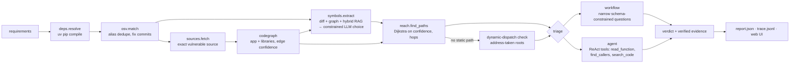

# vigil

**Reachability-aware dependency vulnerability triage, with a local LLM.**

A dependency scanner tells you *"PyYAML 5.3.1 has a critical CVE."* For a three-dependency
Flask app it reports **16 advisories**; for Pillow 9.5.0 alone, **54**. Most of them do not
affect the application, so teams drown in alerts and stop reading them.

vigil answers the question the developer actually has: **does my code use the vulnerable
part, can an attacker reach it, and is it safe to just upgrade?** Every verdict comes with an
evidence trail (call path, `file:line` citations that are machine-verified) and everything
runs locally on a 6 GB laptop GPU (llama.cpp + Qwen3-4B).

```
$ vigil scan benchmarks/cases/yaml_http_full_load
12 packages resolved, 16 advisories matched
call graph: 2116 nodes, 2886 edges, 3 entry points, 51% calls resolved
 exploitable      CVE-2020-14343  pyyaml 5.3.1   CRITICAL  app.import_settings → helpers.parse_config → yaml.full_load
 trigger_not_met  CVE-2023-30861  flask 2.0.1    HIGH      app never uses sessions (searches: \bsession\b … no matches)
 not_reachable    CVE-2025-66471  urllib3 1.26.20 HIGH     …
 …
1 exploitable, 0 need review, 94% of alerts deprioritised with evidence.
```

## Design principle: the LLM only does what code can't

| Step | What happens | Who |
|---|---|---|
| 1 | Resolve the full pinned dependency tree (`uv pip compile`, nothing installed) | code |
| 2 | Match versions against OSV, merge GHSA/PYSEC/CVE aliases, find fix commits | code |
| 3 | Fetch the exact vulnerable source of each dependency on the path to a vulnerable package | code |
| 4 | Build one call graph across app + libraries (imports, re-exports, star imports, inheritance, `self`/`super`, local type inference, callbacks) with per-edge confidence | code |
| 5 | **Advisory → vulnerable functions + trigger conditions.** Candidates come from the fix-commit diff, library functions that reach the changed code, and hybrid retrieval over the library's API. The LLM chooses *only among candidates* — the JSON schema makes the field an enum, so it cannot hallucinate symbols | **LLM** + RAG |
| 6 | Shortest/strongest path from any entry point (HTTP route, CLI, task, `__main__`) to the vulnerable symbols | code |
| 7 | **Exploitability triage:** does the trigger condition hold at the call site, and does attacker-controlled data reach it? | **LLM** (structured workflow or tool-using agent) |
| 8 | **Upgrade impact:** signature diff of the APIs *you call* between versions + LLM review of the relevant changelog entries (RAG) + optional test run in a throwaway venv | code + **LLM** |

## Architecture



### Things that made the difference (each one found by the benchmark or a trace)

- **Grounded generation via constrained decoding.** Symbol extraction uses llama.cpp's JSON-schema grammar
  with an `enum` of real qualified names; it cannot invent `yaml.unsafe_parse()`.
- **Evidence verification.** Every `(file, line, code)` citation in a verdict is checked against the source;
  bad citations are rejected and the model must retry. Traces show the 4B model citing a non-existent
  `app.py:102` and being corrected.
- **Inversion of control.** Framework CVEs (Flask session handling) run inside the framework's request loop,
  never called by app code, so naive reachability says "not reachable" — a false negative. When the app
  instantiates a library class, its public methods become runtime-reachable (`inferred` edges).
- **Unknown ≠ unreachable.** Jinja filters are dispatched through a `FILTERS` dict, PyYAML constructors via
  `add_multi_constructor(...)`. If the vulnerable code is only reachable from an *address-taken* function
  (stored in a registry / passed as a callback) that nothing calls directly, vigil does not claim
  "unreachable"; it routes the alert to feature-usage triage instead. This took the no-LLM baseline from
  83 % to 100 % recall.
- **Workflow beats agent on a small model.** The free-form agent wandered into library internals;
  decomposing triage into narrow questions (trigger at the call site? data source? feature used?) with
  deterministic aggregation is cheaper and more accurate (see results). Search-backed negative evidence
  ("`\bsession\b`: no matches in app or templates") makes "not affected" claims auditable.
- **Confidence everywhere.** Edges are `exact` / `inferred` / `name`; a path is as strong as its weakest
  edge, and the report shows the share of calls statically resolved instead of pretending Python static
  analysis is exact.

## Evaluation

`benchmarks/cases/` holds 19 small applications with **33 labeled (app, CVE) pairs** across PyYAML,
Jinja2, Pillow, lxml, urllib3 and Flask — direct calls, helper indirection, instance attributes, safe flags,
trusted inputs, template-only usage, framework-runtime vulnerabilities. Labels say whether the app is truly
affected and why. Run with `vigil eval`.

<!-- RESULTS -->

Metrics: **recall** = truly-affected alerts that stay flagged (the costly error is missing one);
**alert reduction** = not-affected alerts suppressed; *needs review* counts as flagged.
**Symbol hit** = the extracted vulnerable symbols include a gold symbol (`benchmarks/gold_symbols.json`).

## Quickstart

```bash
uv sync
./scripts/serve.sh                      # llama-server: Qwen3-4B on :8080, nomic-embed on :8081
uv run vigil scan path/to/project       # triage every advisory
uv run vigil scan . --triage agent -v   # use the tool-calling agent instead of the workflow
uv run vigil upgrade pyyaml path/to/project --to 6.0.1   # will the upgrade break me?
uv run vigil serve path/to/project      # web UI: findings, attack-path graph, evidence, agent trace
uv run vigil eval                       # benchmark → benchmarks/results/
uv run pytest                           # deterministic unit tests (no LLM, no network)
```

Environment: `VIGIL_CHAT_URL`, `VIGIL_EMBED_URL`, `VIGIL_CACHE`, `VIGIL_OFFLINE=1` (cache-only, for reproducible
evals), `VIGIL_TEMPERATURE` (default 0), `VIGIL_CHAT_MODEL` for `serve.sh`.

## Layout

```
src/vigil/
  deps.py        dependency resolution + package graph
  osv.py         advisory matching, alias dedupe, fix-commit discovery
  sources.py     exact-version source + changelog fetch (never installs/executes)
  codegraph.py   static call graph with edge confidence, entry points, lifecycle + address-taken analysis
  reach.py       confidence-aware path search
  diffparse.py   fix diff → changed functions in the vulnerable version
  retrieval.py   BM25 + dense embeddings + reciprocal rank fusion
  symbols.py     step A: advisory → vulnerable symbols (grounded, constrained)
  agent.py       step B: tool-using triage agent (budget, loop detection, evidence verification)
  workflow.py    step B: structured triage workflow
  upgrade.py     upgrade impact: API diff + changelog RAG + test run
  llm.py         llama-server client, tracing, validated structured output with retries
  pipeline.py    end-to-end scan
  evaluate.py    benchmark harness + ablations
  web/           FastAPI + single-page UI (Cytoscape attack-path graph, trace viewer)
benchmarks/cases/   labeled applications      tests/   unit tests
```

## Limitations

- Python only. Static analysis cannot see `getattr`/`eval`-style dispatch; vigil over-approximates
  (lifecycle and name-matched edges) and leaves the judgement to triage, which favours recall over precision.
- The benchmark is small and hand-labeled by the author of the tool; treat numbers as indicative.
- Triage quality is bounded by a 4B model; reasoning is sometimes right for the wrong reason (visible in
  traces), which is why evidence is verified and conservative fallbacks map to *needs review*.
