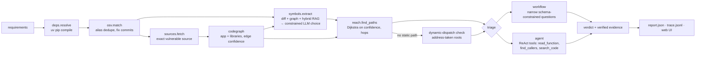

# vigil

**Reachability-aware dependency vulnerability triage, with a local LLM.**

A dependency scanner tells you *"PyYAML 5.3.1 has a critical CVE."* For the four-dependency demo
shop it reports **69 advisories** (Pillow 9.5.0 alone has 54). Most of them do not
affect the application, so teams drown in alerts and stop reading them.

vigil answers the question the developer actually has: **does my code use the vulnerable
part, can an attacker reach it, and is it safe to just upgrade?** Every verdict comes with an
evidence trail (call path, `file:line` citations that are machine-verified) and everything
runs locally on a 6 GB laptop GPU (llama.cpp + Qwen3-4B).

```
$ vigil scan examples/demo_shop
13 packages resolved, 69 advisories matched
 exploitable   CVE-2020-14343  pyyaml 5.3.1    CRITICAL  app.upload_catalog → imports.import_catalog → yaml.loader.FullLoader
 exploitable   CVE-2026-112398 pillow 9.5.0    CRITICAL  app.upload_image → images.make_thumbnail → PIL.Image.open
 needs_review  CVE-2023-30861  flask 2.0.1     HIGH      framework runtime path, app references Flask
 not_reachable CVE-2023-50447  pillow 9.5.0    HIGH      ImageMath is never used
 trigger_not_met CVE-2023-32681 requests 2.25.1 MODERATE no proxy credentials passed to requests.post
 …
5 exploitable, 11 need review, 77% of alerts deprioritised with evidence. 155 LLM calls, 586s.
```


## Design principle: the LLM only does what code can't

| Step | What happens | Who |
|---|---|---|
| 1 | Resolve the full pinned dependency tree (`uv pip compile`, nothing installed) | code |
| 2 | Match versions against OSV, merge GHSA/PYSEC/CVE aliases, find fix commits | code |
| 3 | Fetch the exact vulnerable source of each dependency on the path to a vulnerable package | code |
| 4 | Build one call graph across app + libraries (imports, re-exports, star imports, inheritance, `self`/`super`, local type inference, callbacks) with per-edge confidence | code |
| 5 | **Advisory → vulnerable functions + trigger conditions.** Candidates come from the fix-commit diff, library functions that reach the changed code, and hybrid retrieval over the library's API. The LLM chooses *only among candidates* — the JSON schema makes the field an enum, so it cannot hallucinate symbols | **LLM** + RAG |
| 6 | Shortest/strongest path from any entry point (HTTP route, CLI, task, `__main__`) to the vulnerable symbols | code |
| 7 | **Exploitability triage:** does the trigger condition hold at the call site, and does attacker-controlled data reach it? | **LLM** (structured workflow or tool-using agent) |
| 8 | **Upgrade impact:** signature diff of the APIs *you call* between versions + LLM review of the relevant changelog entries (RAG) + optional test run in a throwaway venv | code + **LLM** |

## Architecture



### Things that made the difference (each one found by the benchmark or a trace)

- **Grounded generation via constrained decoding.** Symbol extraction uses llama.cpp's JSON-schema grammar
  with an `enum` of real qualified names; it cannot invent `yaml.unsafe_parse()`.
- **Evidence verification.** Every `(file, line, code)` citation in a verdict is checked against the source;
  bad citations are rejected and the model must retry. Traces show the 4B model citing a non-existent
  `app.py:102` and being corrected.
- **Inversion of control.** Framework CVEs (Flask session handling) run inside the framework's request loop,
  never called by app code, so naive reachability says "not reachable" — a false negative. When the app
  instantiates a library class, its public methods become runtime-reachable (`inferred` edges).
- **Unknown ≠ unreachable.** Jinja filters are dispatched through a `FILTERS` dict, PyYAML constructors via
  `add_multi_constructor(...)`. If the vulnerable code is only reachable from an *address-taken* function
  (stored in a registry / passed as a callback) that nothing calls directly, vigil does not claim
  "unreachable"; it routes the alert to feature-usage triage instead. This took the no-LLM baseline from
  83% to 100% recall.
- **Workflow beats agent on a small model.** The free-form agent wandered into library internals;
  decomposing triage into narrow questions (trigger at the call site? data source? feature used?) with
  deterministic aggregation is cheaper and more accurate (see results). "Not affected" claims based on
  absence need search evidence that includes deterministic anchors, not only model-chosen patterns.
- **Confidence everywhere.** Edges are `exact` / `inferred` / `name`; a path is as strong as its weakest
  edge, and the report shows the share of calls statically resolved instead of pretending Python static
  analysis is exact.

## Evaluation

`benchmarks/cases/` holds 19 small applications with **33 labeled (app, CVE) pairs** across PyYAML,
Jinja2, Pillow, lxml, urllib3 and Flask — direct calls, helper indirection, instance attributes, safe flags,
trusted inputs, template-only usage, framework-runtime vulnerabilities. Labels say whether the app is truly
affected and why. Run with `vigil eval`.

### Results (Qwen3-4B Q5_K_M on an RTX 4050 6 GB, temperature 0)

| config | recall (affected caught) | alert reduction | precision | accuracy | needs review | symbol hit | LLM calls | time |
|---|---|---|---|---|---|---|---|---|
| scanner (pip-audit-style) | 100% (12/12) | 0% (0/21) | 36% | 36% | 0% | – | 0 | – |
| reach-diff (no LLM) | 100% (12/12) | 10% (2/21) | 39% | 42% | 82% | 79% | 0 | 49 s |
| reach-llm (step A only) | 100% (12/12) | 10% (2/21) | 39% | 42% | 94% | 100% | 33 | 193 s |
| **workflow** (A + structured triage) | **83% (10/12)** | **81% (17/21)** | **71%** | **82%** | 21% | 97% | 92 | 290 s |
| agent (A + ReAct triage) | 83% (10/12) | 52% (11/21) | 50% | 64% | 18% | 97% | 209 | 492 s |

**Retrieval** (advisory text → gold vulnerable symbol among the library's public API, n = 11 advisories):

| method | recall@5 | recall@10 | recall@20 |
|---|---|---|---|
| BM25 | 64% | 82% | 82% |
| dense (nomic-embed) | 91% | 100% | 100% |
| hybrid (RRF) | 82% | 100% | 100% |

What the numbers say:

- **Static reachability alone barely helps** (10% alert reduction): to stay sound it must over-approximate
  (framework runtime, dynamic dispatch, name-matched edges), so almost everything stays "maybe".
  The LLM steps are what turn "maybe" into a decision, which is exactly where generative AI earns its place.
- **LLM symbol extraction beats fix-diff symbols** (100% vs 79% gold-symbol hit): diffs touch internals,
  tests and refactors; the advisory prose names the public entry points.
- **Workflow > agent on a 4B model**: same recall, +29 pts alert reduction, 2.3× fewer LLM calls.
  The agent tends to wander into library internals and declare framework CVEs exploitable.
- **Variance is real.** With 12 positive pairs one case is 8 pts. Across the last code revisions workflow
  recall moved 92% → 83% because a single Jinja sandbox case flipped when prompts changed slightly
  (temperature 0, but a 4B model is prompt-sensitive). Treat differences under ~10 pts as noise.
- **Hybrid retrieval did not beat dense** on this small set (BM25 drags recall@5 down); kept because BM25 is
  robust for exact identifiers, but the measurement is reported as is.

**How the benchmark drove the design** (workflow recall across iterations: 33% → 67% → 92% → 83%):

1. 33%: traces showed the triage asking "is the feature used?" with model-chosen regexes like
   `lxml\.html\.clean\.Cleaner\.__call__` that never appear in app code → "no matches" → "not affected".
   Fix: module-level instance tracking (`http = PoolManager()` then `http.request(...)`) so these become
   direct call paths, plus deterministic *anchor* searches that must also be empty before "not used" is allowed.
2. Also found: the benchmark's `labels.json` was searchable by the model (label leakage). Hidden.
3. 67%: lifecycle edges outranked real call paths; template filters are used as `|xmlattr`, not `do_xmlattr`.
   Fix: a separate `runtime` confidence tier ranked below resolved calls, and capturing the registry key a
   function is stored under (`FILTERS = {"xmlattr": do_xmlattr}`) as a search anchor.

4. A realistic demo app (`examples/demo_shop`, 69 advisories) exposed what the benchmark did not:
   the LLM sometimes *dropped* a symbol the advisory names verbatim ("the FullLoader loader"), turning a
   critical CVE into a silent "not reachable", and labelled an HTTP upload "input trusted". Fixes:
   candidates named in the advisory text are always kept (the LLM can add symbols, never remove the
   obvious ones), and "input trusted" is downgraded when the entry point is an HTTP handler reading
   `request.*`.

Remaining errors (workflow): the Jinja sandbox CVEs when **attackers author the templates** (the vulnerable
feature lives in attacker input, not app code — a blind spot of usage search); a bundled config file judged
attacker-controlled (false positive, the cheap error); three conservative *needs review*.

**Demo app** (`examples/demo_shop`: Flask + PyYAML + requests + Pillow, 69 advisories): 5 exploitable,
11 need review, 77% deprioritised, in ~10 min on the laptop GPU. Its Pillow image-parser CVEs show a further
weakness: they trigger on the *file format the attacker chooses* inside `Image.open`, and the 4B model often
argues "`thumbnail()` does not trigger it". Expect a larger model, or format-aware rules, to be needed there.


Metrics: **recall** = truly-affected alerts that stay flagged (the costly error is missing one);
**alert reduction** = not-affected alerts suppressed; *needs review* counts as flagged.
**Symbol hit** = the extracted vulnerable symbols include a gold symbol (`benchmarks/gold_symbols.json`).

## Quickstart

```bash
uv sync
./scripts/serve.sh                      # llama-server: Qwen3-4B on :8080, nomic-embed on :8081
uv run vigil scan path/to/project       # triage every advisory
uv run vigil scan . --triage agent -v   # use the tool-calling agent instead of the workflow
uv run vigil upgrade pyyaml path/to/project --to 6.0.1   # will the upgrade break me?
uv run vigil serve path/to/project      # web UI: findings, attack-path graph, evidence, agent trace
uv run vigil eval                       # benchmark → benchmarks/results/
uv run pytest                           # deterministic unit tests (no LLM, no network)
```

Environment: `VIGIL_CHAT_URL`, `VIGIL_EMBED_URL`, `VIGIL_CACHE`, `VIGIL_OFFLINE=1` (cache-only, for reproducible
evals), `VIGIL_TEMPERATURE` (default 0), `VIGIL_CHAT_MODEL` for `serve.sh`.

## Layout

```
src/vigil/
  deps.py        dependency resolution + package graph
  osv.py         advisory matching, alias dedupe, fix-commit discovery
  sources.py     exact-version source + changelog fetch (never installs/executes)
  codegraph.py   static call graph with edge confidence, entry points, lifecycle + address-taken analysis
  reach.py       confidence-aware path search
  diffparse.py   fix diff → changed functions in the vulnerable version
  retrieval.py   BM25 + dense embeddings + reciprocal rank fusion
  symbols.py     step A: advisory → vulnerable symbols (grounded, constrained)
  agent.py       step B: tool-using triage agent (budget, loop detection, evidence verification)
  workflow.py    step B: structured triage workflow
  upgrade.py     upgrade impact: API diff + changelog RAG + test run
  llm.py         llama-server client, tracing, validated structured output with retries
  pipeline.py    end-to-end scan
  evaluate.py    benchmark harness + ablations
  web/           FastAPI + single-page UI (Cytoscape attack-path graph, trace viewer)
benchmarks/cases/   labeled applications      tests/   unit tests
```

## Limitations

- Python only. Static analysis cannot see `getattr`/`eval`-style dispatch; vigil over-approximates
  (lifecycle and name-matched edges) and leaves the judgement to triage, which favours recall over precision.
- The benchmark is small and hand-labeled by the author of the tool; treat numbers as indicative.
- Triage quality is bounded by a 4B model; reasoning is sometimes right for the wrong reason (visible in
  traces), which is why evidence is verified and conservative fallbacks map to *needs review*.
