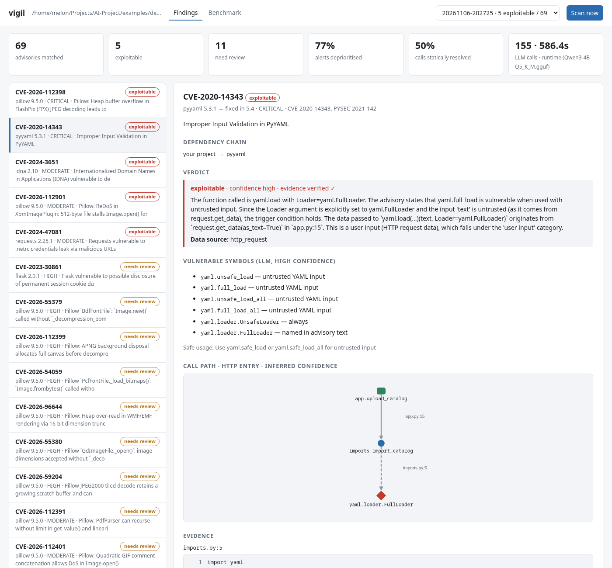
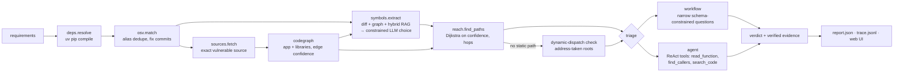
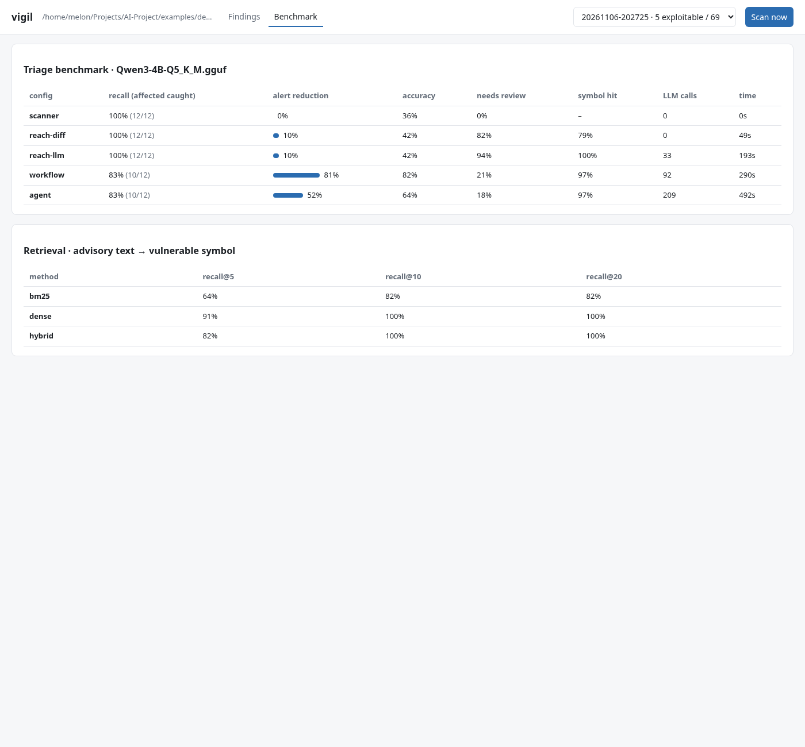

# vigil

**Reachability-aware dependency vulnerability triage, powered by a local LLM.**

[](https://github.com/xmasdev/vigil/actions/workflows/ci.yml)

-green)


A dependency scanner tells you *"PyYAML 5.3.1 has a critical CVE."* For a small four-dependency web app it
reports **69 advisories** (Pillow 9.5.0 alone has 54). Most of them don't affect the application, so teams
drown in alerts and stop reading them.

vigil answers the question the developer actually has:

> **Does my code use the vulnerable part? Can an attacker reach it? Is it safe to just upgrade?**

Every verdict comes with an evidence trail — the call path from an entry point to the vulnerable function,
and `file:line` citations that are machine-verified against the source. Everything runs locally on a 6 GB
laptop GPU (llama.cpp + Qwen3-4B); no code leaves your machine.



## Contents

- [What it does](#what-it-does)
- [How it works](#how-it-works)
- [Evaluation](#evaluation)
- [Installation](#installation)
- [Usage](#usage)
- [Project layout](#project-layout)
- [Limitations](#limitations)

## What it does

```
$ vigil scan examples/demo_shop
13 packages resolved, 69 advisories matched
 exploitable     CVE-2020-14343  pyyaml 5.3.1    CRITICAL  app.upload_catalog → imports.import_catalog → yaml.loader.FullLoader
 exploitable     CVE-2026-112398 pillow 9.5.0    CRITICAL  app.upload_image → images.make_thumbnail → PIL.Image.open
 needs_review    CVE-2023-30861  flask 2.0.1     HIGH      framework runtime path, app references Flask
 not_reachable   CVE-2023-50447  pillow 9.5.0    HIGH      ImageMath is never used
 trigger_not_met CVE-2023-32681  requests 2.25.1 MODERATE  no proxy credentials passed to requests.post
 …
5 exploitable, 11 need review, 77% of alerts deprioritised with evidence. 155 LLM calls, 586s.
```

Each advisory gets one of these statuses:

| Status | Meaning |
|---|---|
| `exploitable` | Attacker-controlled data reaches the vulnerable code and the trigger condition holds |
| `needs_review` | Reachable, but vigil can't decide safely — a human should look |
| `trigger_not_met` | The vulnerable code is called, but not in the dangerous way (e.g. `Loader=SafeLoader`) |
| `input_trusted` | The data reaching it comes only from trusted sources (constants, bundled files) |
| `not_reachable` | No call path from any entry point of the application |

It also answers the follow-up question, *"will upgrading break my code?"*:

```
$ vigil upgrade pyyaml examples/upgrade_yaml_legacy --to 6.0.1
pyyaml 5.3.1 → 6.0.1: high risk
APIs you use: yaml.dump, yaml.load, yaml.load_all, yaml.loader.FullLoader
  • yaml.load: new_required_param — parameter 'Loader' is required but not passed  (fixtures.py:7)
```

The minimal fixed version (`5.4`) is reported as low risk for the same project.

## How it works

### Design principle: the LLM only does what code can't

Matching package versions against a CVE database doesn't need an LLM, so vigil doesn't use one there.
Generative AI is used only where unstructured text or code has to be *understood*.

| Step | What happens | Who |
|---|---|---|
| 1 | Resolve the full pinned dependency tree (`uv pip compile`, nothing installed) | code |
| 2 | Match versions against [OSV](https://osv.dev), merge GHSA/PYSEC/CVE aliases, find fix commits | code |
| 3 | Fetch the exact vulnerable source of every dependency on the path to a vulnerable package (never executed) | code |
| 4 | Build one call graph across app + libraries — imports, re-exports, star imports, inheritance, `self`/`super`, local and module-level type inference, callbacks — with a confidence on every edge | code |
| 5 | **Advisory → vulnerable functions + trigger conditions.** Candidates come from the fix-commit diff, library functions that reach the changed code, and hybrid retrieval over the library's API. The LLM chooses *only among candidates*: the JSON schema makes the field an enum, so it can't invent function names | **LLM** + RAG |
| 6 | Strongest/shortest path from any entry point (HTTP route, CLI command, task, `__main__`) to the vulnerable functions | code |
| 7 | **Exploitability triage:** does the trigger condition hold at the call site, and does attacker-controlled data reach it? | **LLM** |
| 8 | **Upgrade impact:** signature diff of the APIs *you call* between versions, LLM review of the relevant changelog entries (RAG), optional test run in a throwaway venv | code + **LLM** |

### Architecture



### Techniques that made the difference

Each of these was found by the benchmark or by reading an agent trace.

- **Grounded generation via constrained decoding.** Symbol extraction uses llama.cpp's JSON-schema grammar
  with an `enum` of real qualified names, so the model can't invent `yaml.unsafe_parse()`.
- **Evidence verification.** Every `(file, line, code)` citation in a verdict is checked against the source;
  bad citations are rejected and the model must retry. Traces show the 4B model citing a non-existent
  `app.py:102` and being corrected.
- **Recall floor for symbols.** Functions the advisory names verbatim (*"the FullLoader loader"*) are always
  kept, so the LLM can add symbols but never silently drop the obvious ones.
- **Inversion of control.** Framework CVEs (Flask session handling) run inside the framework's request loop and
  are never called by app code, so naive reachability says "not reachable" — a false negative. When the app
  instantiates a library class, its public methods become reachable through `runtime` edges.
- **Unknown ≠ unreachable.** Jinja filters are dispatched through a `FILTERS` dict, PyYAML constructors through
  `add_multi_constructor(...)`. If vulnerable code is only reachable from an *address-taken* function (stored in
  a registry or passed as a callback) that nothing calls directly, vigil routes the alert to feature-usage triage
  instead of claiming "unreachable". The registry key (`"xmlattr"` for `do_xmlattr`) becomes a search anchor,
  so template usage like `{{ attrs|xmlattr }}` is found.
- **Workflow beats agent on a small model.** The free-form agent wandered into library internals. Splitting
  triage into narrow questions (trigger at the call site? data source? feature used?) with deterministic
  aggregation is cheaper and more accurate. "Not affected because unused" requires deterministic searches to
  come back empty too, not just the model's own regexes.
- **Deterministic guards on LLM answers.** "Input trusted" is downgraded to *needs review* when the entry point is
  an HTTP handler that reads `request.*`.
- **Confidence everywhere.** Edges are `exact` / `inferred` / `runtime` / `name`; a path is as strong as its
  weakest edge, and the report shows the share of calls statically resolved instead of pretending Python static
  analysis is exact.

## Evaluation

`benchmarks/cases/` holds **19 small applications with 33 labeled (app, CVE) pairs** across PyYAML, Jinja2,
Pillow, lxml, urllib3 and Flask: direct calls, helper indirection, instance attributes, safe flags, trusted
inputs, template-only usage, and framework-runtime vulnerabilities. Each `labels.json` says whether the app is
truly affected and why. Run it with `vigil eval`.

Five configurations form an ablation ladder:

- **scanner** — flag every matched advisory (what pip-audit / Dependabot do)
- **reach-diff** — fix-commit symbols + call-graph reachability, no LLM
- **reach-llm** — LLM-extracted symbols + reachability (step 5 only)
- **workflow** — + structured triage (the default)
- **agent** — + free-form tool-using triage agent

### Results (Qwen3-4B Q5_K_M on an RTX 4050 6 GB, temperature 0)

| config | recall (affected caught) | alert reduction | precision | accuracy | needs review | symbol hit | LLM calls | time |
|---|---|---|---|---|---|---|---|---|
| scanner | 100% (12/12) | 0% (0/21) | 36% | 36% | 0% | – | 0 | – |
| reach-diff (no LLM) | 100% (12/12) | 10% (2/21) | 39% | 42% | 82% | 79% | 0 | 49 s |
| reach-llm | 100% (12/12) | 10% (2/21) | 39% | 42% | 94% | 100% | 33 | 193 s |
| **workflow** | **83% (10/12)** | **81% (17/21)** | **71%** | **82%** | 21% | 97% | 92 | 290 s |
| agent | 83% (10/12) | 52% (11/21) | 50% | 64% | 18% | 97% | 209 | 492 s |

**Retrieval** (advisory text → gold vulnerable function among the library's public API, n = 11 advisories):

| method | recall@5 | recall@10 | recall@20 |
|---|---|---|---|
| BM25 | 64% | 82% | 82% |
| dense (nomic-embed) | 91% | 100% | 100% |
| hybrid (RRF) | 82% | 100% | 100% |

Metrics: **recall** = truly-affected alerts that stay flagged (the costly error is missing one);
**alert reduction** = not-affected alerts suppressed; *needs review* counts as flagged;
**symbol hit** = the extracted vulnerable functions include a gold one (`benchmarks/gold_symbols.json`).



### What the numbers say

- **Static reachability alone barely helps** (10% alert reduction). To stay sound it must over-approximate
  (framework runtime, dynamic dispatch, name-matched edges), so almost everything stays "maybe". The LLM steps
  turn "maybe" into a decision — that's where generative AI earns its place here.
- **LLM symbol extraction beats fix-diff symbols** (100% vs 79% gold-symbol hit). Diffs touch internals, tests
  and refactors; the advisory prose names the public entry points.
- **Workflow > agent on a 4B model**: same recall, +29 pts alert reduction, 2.3× fewer LLM calls.
- **Variance is real.** With 12 positive pairs, one case is 8 pts. Across the last code revisions workflow
  recall moved 92% → 83% because a single Jinja sandbox case flipped when prompts changed slightly (temperature
  0, but a 4B model is prompt-sensitive). Treat differences under ~10 pts as noise.
- **Hybrid retrieval didn't beat dense** on this small set (BM25 drags recall@5 down). It's kept because BM25 is
  robust for exact identifiers, but the measurement is reported as is.

### How the benchmark drove the design

Workflow recall across iterations: **33% → 67% → 92% → 83%**.

1. **33%.** Traces showed triage asking "is the feature used?" with model-chosen regexes like
   `lxml\.html\.clean\.Cleaner\.__call__` that never appear in app code → "no matches" → "not affected".
   Fix: module-level instance tracking (`http = PoolManager()` then `http.request(...)`) so these become direct
   call paths, plus deterministic anchor searches that must also be empty before "not used" is allowed.
2. **Label leakage.** The benchmark's `labels.json` was searchable by the model. Now hidden from all tools.
3. **67%.** Framework-runtime edges outranked real call paths, and template filters are used as `|xmlattr`, not
   `do_xmlattr`. Fix: a separate `runtime` confidence tier ranked below resolved calls, and registry keys as
   search anchors.
4. **Demo app.** A realistic app (`examples/demo_shop`, 69 advisories) exposed what the benchmark didn't: the LLM
   sometimes *dropped* a function the advisory names verbatim, turning a critical CVE into a silent "not
   reachable", and labelled an HTTP upload "input trusted". Fix: the recall floor and the HTTP data-source guard.

**Remaining errors (workflow):** the Jinja sandbox CVEs when attackers author the templates (the vulnerable
feature lives in attacker input, not in app code — a blind spot of usage search); a bundled config file judged
attacker-controlled (a false positive, the cheap error); three conservative *needs review*.

## Installation

Requirements: Python 3.12+, [uv](https://docs.astral.sh/uv/), [llama.cpp](https://github.com/ggml-org/llama.cpp)
built with GPU support (CPU works, slowly), and ~3 GB of free VRAM.

```bash
git clone https://github.com/xmasdev/vigil.git && cd vigil
uv sync

# models (any OpenAI-compatible server works; these are the defaults)
mkdir -p ~/models/llama.cpp && cd ~/models/llama.cpp
curl -LO https://huggingface.co/Qwen/Qwen3-4B-GGUF/resolve/main/Qwen3-4B-Q5_K_M.gguf
curl -LO https://huggingface.co/nomic-ai/nomic-embed-text-v1.5-GGUF/resolve/main/nomic-embed-text-v1.5.Q8_0.gguf
cd -

./scripts/serve.sh   # chat model on :8080 (GPU), embeddings on :8081 (CPU)
```

`serve.sh` reads `LLAMA_CPP` (default `~/llama.cpp/build/bin`), `MODELS_DIR`, `VIGIL_CHAT_MODEL`,
`VIGIL_EMBED_MODEL` and `VIGIL_CTX` (context size, default 16384). Only one chat model fits in 6 GB, so stop the
servers (`pkill llama-server`) before switching models.

## Usage

```bash
uv run vigil scan path/to/project              # triage every advisory (structured workflow)
uv run vigil scan . --triage agent -v          # use the tool-calling agent; -v prints reasoning
uv run vigil scan . --no-llm                   # deterministic only: resolution, matching, reachability
uv run vigil scan . --only CVE-2020-14343      # restrict to specific advisories
uv run vigil upgrade pyyaml path/to/project    # will the minimal fixed version break me?
uv run vigil upgrade pyyaml . --to 6.0.1 --run-tests   # also run pytest against the upgrade in a temp venv
uv run vigil serve path/to/project             # web UI on http://localhost:8765
uv run vigil eval                              # benchmark → benchmarks/results/
uv run pytest                                  # unit tests (no LLM, no network)
```

Each scan writes `.vigil/runs/<timestamp>/report.json` (findings, paths, verdicts, evidence) and `trace.jsonl`
(every LLM call, tool call, validation failure and verdict) inside the scanned project. The web UI reads both:
findings ranked by priority, the attack path as a graph, evidence snippets, and the full trace per finding.

Environment variables: `VIGIL_CHAT_URL` (default `http://localhost:8080/v1`), `VIGIL_EMBED_URL`, `VIGIL_CACHE`
(default `~/.cache/vigil`), `VIGIL_OFFLINE=1` (cache only, for reproducible evals), `VIGIL_TEMPERATURE` (default 0).

### Adding a benchmark case

Create `benchmarks/cases/<name>/` with a pinned `requirements.txt`, the application code, and a `labels.json`:

```json
{"description": "Uploaded file parsed by yaml.load with FullLoader held in an instance attribute.",
 "labels": {"CVE-2020-14343": {"affected": true, "reason": "exploitable"}}}
```

Only labeled advisories are scored. Optionally add gold symbol prefixes to `benchmarks/gold_symbols.json`.

## Project layout

```
src/vigil/
  deps.py        dependency resolution + package graph
  osv.py         advisory matching, alias dedupe, fix-commit discovery
  sources.py     exact-version source + changelog fetch (never installs or executes)
  codegraph.py   static call graph: edge confidence, entry points, lifecycle + address-taken analysis
  reach.py       confidence-aware path search
  diffparse.py   fix diff → changed functions in the vulnerable version
  retrieval.py   BM25 + dense embeddings + reciprocal rank fusion
  symbols.py     advisory → vulnerable functions (grounded, constrained, recall floor)
  workflow.py    structured triage workflow (default)
  agent.py       tool-using triage agent: budget, loop detection, evidence verification
  upgrade.py     upgrade impact: API diff + changelog RAG + test run
  llm.py         llama-server client, tracing, validated structured output with retries
  pipeline.py    end-to-end scan
  evaluate.py    benchmark harness + ablations
  web/           FastAPI + single-page UI (Cytoscape attack-path graph, trace viewer)
benchmarks/      labeled cases, gold symbols, results
examples/        demo_shop (realistic app), upgrade_yaml_legacy (breaking upgrade)
tests/           unit tests for the deterministic core
scripts/serve.sh starts the local model servers
```

## Limitations

- **Python only.** Static analysis can't see `getattr`/`eval`-style dispatch; vigil over-approximates (runtime and
  name-matched edges) and leaves the judgement to triage, which favours recall over precision.
- **Small benchmark.** 33 pairs, hand-labeled by the tool's author; treat the numbers as indicative.
- **4B model limits.** Reasoning is sometimes right for the wrong reason (visible in traces), which is why evidence
  is verified and uncertain cases fall back to *needs review*. Pillow image-parser CVEs trigger on the file format
  the attacker chooses inside `Image.open`, and the model often argues "`thumbnail()` doesn't trigger it"; a larger
  model or format-aware rules would be needed there.
- **Attacker-authored content.** When attackers supply templates or expressions, the vulnerable feature lives in
  their input rather than in app code, and usage search can't see it.

## License

[MIT](LICENSE)
